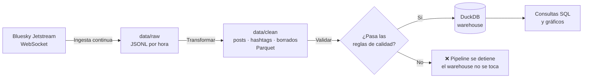
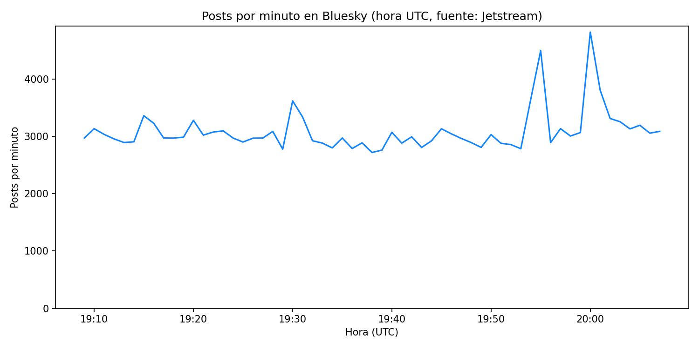
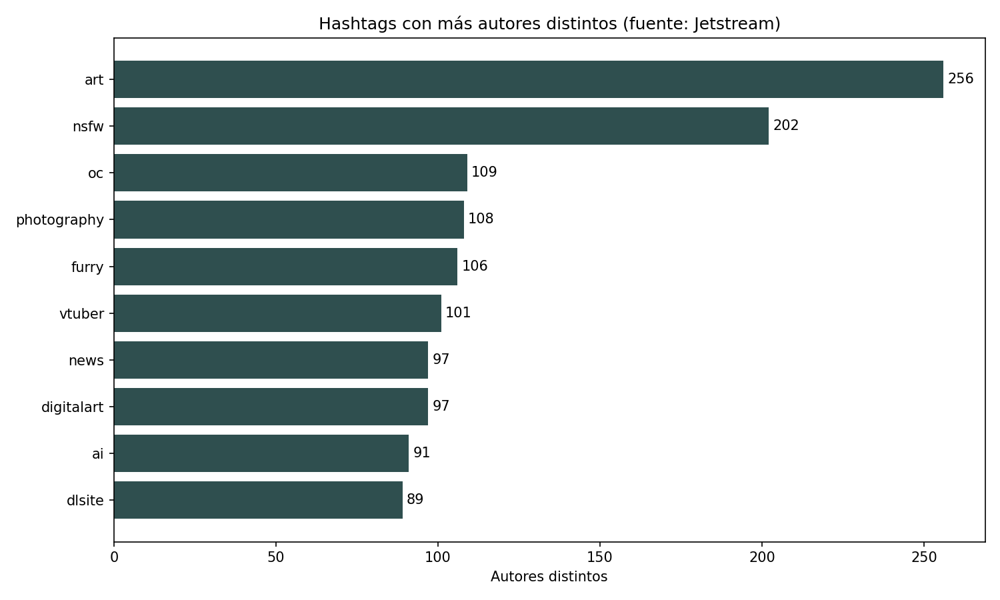
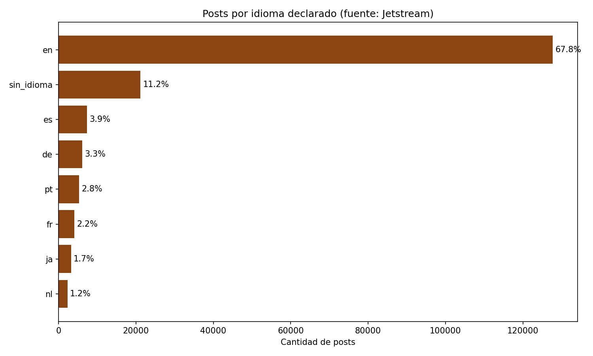

# 🦋 Pipeline de Streaming de Bluesky

Pipeline de datos que captura en tiempo real los posts de **Bluesky** desde su servicio público **Jetstream**, los limpia y normaliza en tres tablas, valida su calidad y los carga en un warehouse **DuckDB** para analizar idiomas, hashtags y ritmo de publicación con SQL.

> Proyecto de portafolio de ingeniería de datos. Complementa mi proyecto batch de [autos antiguos](https://github.com/icanalesvillagra/autos-antiguos): aquí los datos no se piden, **llegan solos y sin parar**.

---

## ❓ Preguntas que responde

- ¿Qué hashtags son usados por más autores distintos (y no solo repetidos por una cuenta)?
- ¿En qué idiomas se publica?
- ¿Cuál es el ritmo de publicación a lo largo del tiempo?

---

## 🏗️ Arquitectura



| Etapa | Script | Qué hace |
|---|---|---|
| **Ingesta** | `ingestion/listen.py` | Escucha el WebSocket sin parar. Reconecta con espera exponencial, retoma desde el último `cursor` y escribe por lotes en archivos JSONL por hora. |
| **Transformar** | `transform/limpiar.py` | Separa los eventos en tres tablas, extrae hashtags, elimina duplicados y convierte tiempos. Escribe Parquet. |
| **Validar** | `quality/validar.py` | Ejecuta reglas de calidad en SQL. Si alguna falla, detiene el pipeline antes de la carga. |
| **Cargar** | `load/cargar.py` | Carga las tres tablas en DuckDB con `CREATE OR REPLACE` (idempotente). |
| **Orquestación** | `pipeline.py` | Ejecuta transformar → validar → cargar → graficar, mide tiempos y se detiene ante el primer error. |

La ingesta corre **aparte** del pipeline: es un proceso continuo, y el pipeline procesa lo que haya acumulado.

---

## 🛠️ Stack

- **Python** (websockets, asyncio, pandas)
- **DuckDB** como warehouse local y **Parquet** como formato intermedio
- **SQL** para validaciones y análisis (funciones de ventana, anti-joins)
- **matplotlib** para los gráficos
- **Git** para control de versiones

---

## 📁 Estructura del proyecto

```
pipeline-bluesky/
├── ingestion/
│   ├── listen.py         # Ingesta continua con reconexión
│   └── explore.py        # Perfilamiento inicial de los datos
├── transform/
│   └── limpiar.py        # Limpieza y normalización
├── quality/
│   └── validar.py        # Reglas de calidad
├── load/
│   └── cargar.py         # Carga al warehouse
├── analisis/
│   ├── consultas.py      # Consultas de análisis
│   └── graficos.py       # Gráficos
├── docs/img/             # Gráficos generados
├── pipeline.py           # Orquestador
├── requirements.txt
└── .gitignore            # data/ y warehouse/ no se versionan
```

---

## ▶️ Cómo ejecutarlo

Requiere Python 3.10 o superior.

```bash
git clone https://github.com/icanalesvillagra/pipeline-bluesky.git
cd pipeline-bluesky
python -m venv .venv

# Windows
.venv\Scripts\Activate.ps1
# Linux / macOS
source .venv/bin/activate

pip install -r requirements.txt

python ingestion/listen.py 600    # captura 10 minutos (sin número, corre hasta Ctrl + C)
python pipeline.py                # transforma, valida, carga y grafica
python analisis/consultas.py      # imprime los resultados
```

---

## 🧠 Decisiones de diseño

**1. El dato crudo no se modifica.**
Todo lo que llega, incluidos borrados y eventos de cuenta, se guarda tal cual en JSONL. Descartar o interpretar es trabajo de la capa siguiente, y así cualquier regla de limpieza se puede cambiar y reprocesar.

**2. Ingesta resistente a caídas.**
Si la conexión se corta, el script espera 1 s, 2 s, 4 s... (hasta 60 s) y reconecta pidiendo los eventos desde el último `time_us` recibido. Al terminar o ser interrumpido, guarda lo que quedaba en memoria.

**3. Entrega "al menos una vez".**
Al reconectar con un cursor, un evento puede llegar dos veces. Por eso los posts se deduplican por `(did, rkey)`.

**4. Tres tablas, un grano claro cada una.**

| Tabla | Una fila por... |
|---|---|
| `posts` | post creado (`did` + `rkey`) |
| `hashtags` | hashtag dentro de un post |
| `borrados` | evento de borrado |

Los hashtags van aparte porque un post puede tener 0 o varios, y una lista dentro de una celda complica el SQL.

**5. Hora confiable: `time_us`, no `createdAt`.**
`createdAt` lo declara el cliente del usuario y puede ser incorrecto. `time_us` lo registra el servidor de Bluesky.

**6. Los borrados se registran, no se aplican.**
Un borrado puede apuntar a un post publicado antes de que empezara la captura, así que no se puede asumir que exista en `posts`.

**7. Hashtags por autores distintos, no por cantidad de posts.**
Un hashtag usado 50 veces por una sola cuenta no es una tendencia. Ordenar por `COUNT(DISTINCT did)` separa el uso real de la repetición.

**8. Sin filtro de contenido.**
El ranking de hashtags incluye contenido para adultos (por ejemplo, `nsfw`) porque forma parte de la actividad real de la plataforma, y filtrarlo sesgaría la medición. El proyecto solo agrega y cuenta; no publica textos de posts ni identificadores de usuarios (`data/` no se versiona).

**9. Validar antes de cargar, y carga idempotente.**
Si una regla falla, el warehouse conserva su última versión válida. `CREATE OR REPLACE` garantiza el mismo resultado sin importar cuántas veces se ejecute.

**10. Parquet en vez de CSV.**
Formato de columnas, comprimido y con tipos (fechas reales). Es el estándar en ingeniería de datos.

---

## ✅ Reglas de calidad

| Regla | Por qué |
|---|---|
| Al menos 100 posts | Detecta capturas vacías o una ingesta rota. |
| `(did, rkey)` único en `posts` | Garantiza el grano y que la deduplicación funcionó. |
| Fechas entre 2023 y mañana | Detecta tiempos corruptos. |
| Máximo 25% de posts sin idioma | Si sube, algo cambió en el formato de los datos. |
| Todo hashtag pertenece a un post existente | Integridad entre tablas (equivale a una llave foránea). |
| `(did, rkey)` único en `borrados` | Garantiza el grano de la tabla. |

---

## 📊 Resultados

*Captura de referencia: aproximadamente 1 hora el 12-11-2026 (unas 19:08 a 20:08 UTC), más dos capturas cortas anteriores. Total: 198.835 eventos → 188.482 posts, 54.024 filas de hashtags y 7.794 borrados; 2.559 eventos ignorados (cuenta e identidad).*

- **Ritmo:** unos 3.000 posts por minuto en promedio (~50 por segundo), con dos picos cercanos a 4.500–4.800.
- **Idiomas:** inglés concentra el 67,8% de los posts; el 11,2% no declara idioma. El español representa el 3,9%.
- **Hashtags:** `art` lidera con 256 autores distintos, seguido de `nsfw` (202), `oc`, `photography` y `furry`.
- **Concentración:** la cuenta más activa publicó 1.819 posts en la hora (ritmo difícil de sostener para una persona, probablemente automatizada), pero las 5 más activas suman menos del 2% del total.





---

## ⚠️ Limitaciones

- **Ventana corta.** Una hora de captura no permite hablar de tendencias diarias ni semanales. Los rankings describen ese momento, no Bluesky en general.
- **Solo posts.** Se piden únicamente posts; no hay likes, follows ni reposts, así que no se mide "alcance" ni popularidad.
- **El idioma es el que declara el cliente.** Un 11% de los posts no declara ninguno, y el declarado puede ser incorrecto. No se detecta el idioma a partir del texto.
- **Borrados parciales.** La mayoría de los borrados apunta a posts publicados antes de la captura, así que no se puede calcular una tasa de borrado confiable.
- **Deduplicación sin ejercitar.** En la captura de referencia no hubo duplicados, así que esa lógica y la reconexión no se han probado con datos reales de una caída.
- **Cuentas automatizadas.** No se detectan ni se filtran bots; el ranking por autores distintos reduce su efecto, pero no lo elimina.
- **Todo en memoria.** La transformación carga todos los eventos a la vez. Funciona con cientos de miles; con millones habría que procesar archivo por archivo.
- **Reprocesa todo en cada ejecución.** Con más datos acumulados se vuelve lento; el siguiente paso sería una carga incremental.

---

## 🚀 Próximos pasos

- [ ] Carga incremental: procesar solo los archivos nuevos.
- [ ] Probar la reconexión y la deduplicación provocando una caída de red.
- [ ] Capturas de varios días para analizar patrones por hora y por día.
- [ ] Migrar las transformaciones a **dbt** sobre DuckDB.
- [ ] Orquestación con **Airflow** o **Dagster**, con ejecución programada.
- [ ] Llevar el warehouse a la nube (Snowflake o Databricks).

---

## 👤 Autor

**Ignacio Canales Villagra**, Ingeniero en Informática
[LinkedIn](https://linkedin.com/in/icanalesvillagra) · [GitHub](https://github.com/icanalesvillagra)